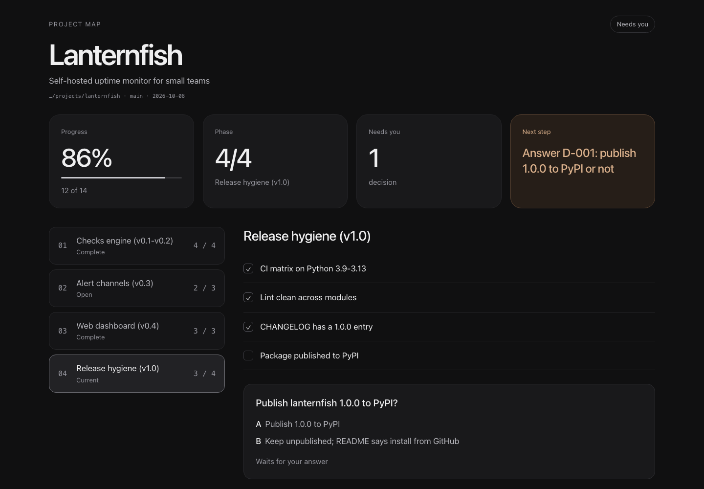
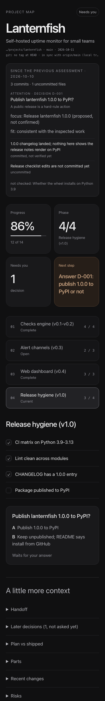

[](https://hol.org/registry/plugins/bokiko%2Fproject-map)

<!-- HEADER: Capsule-render wave banner -->
<p align="center">
  
</p>

<!-- PRIMARY BADGES: for-the-badge style -->
<p align="center">
  <a href="https://github.com/bokiko/claude-project-map#get-started-in-3-steps"></a>
  <a href="https://x.com/bokiko"></a>
</p>

<!-- TECH BADGES: flat-square style, unified color 2ecc71 -->
<p align="center">
  
  
  
  
  
  <a href="https://github.com/bokiko/claude-project-map/actions/workflows/plugin-scanner.yml"></a>
  <a href="https://github.com/hashgraph-online/awesome-ai-plugins"></a>
</p>

<!-- TYPING SVG: animated tagline -->
<p align="center">
  <a href="https://git.io/typing-svg"></a>
</p>

---

<p align="center">
  
</p>

<details>
<summary>On a phone</summary>
<p align="center">
  
</p>
</details>

**project-map is a Claude Code plugin.** It adds one skill, the slash command `/project-map`, to [Claude Code](https://claude.com/claude-code), Anthropic's coding agent for the terminal. It is not a standalone program: you type the command inside a Claude Code session, and Claude does the rest.

The command gives you a one-page view of where your project stands.
It shows what is done, what comes next, and what needs your decision.
Open the page in your browser, or read a short summary in Claude Code.

**Needs:** Claude Code 2.1 (tested with 2.1.296), plus `python3` 3.9+, `jq` and `git`, on macOS or Linux. Google Chrome or Chromium is optional: a full rebuild uses it to check the page at desktop and phone width (the macOS app, or `/usr/bin/google-chrome`, `/usr/bin/chromium`, `/usr/bin/chromium-browser`), and skips that check without it. It maps any project folder inside your home folder, such as `~/code/my-app` or `~/projects/my-app`. It never maps the home folder itself, hidden folders like `~/.config`, or `~/Library`, and the path must not contain spaces or brackets.

## Get started in 3 steps

1. **Install from GitHub.** Paste these commands into your terminal:

   ```bash
   claude plugin marketplace add bokiko/claude-project-map
   claude plugin install project-map@bokiko-tools
   ```

2. **Run `/reload-plugins` (or open a new Claude Code session).** The plugin's safety checks (hooks) load at session start and at `/reload-plugins`, nothing else. A session that has not done either will not have them.

3. **Make your map.** Open Claude Code in your project folder and type the skill's command at the Claude prompt (not in your shell):

   ```text
   /project-map
   ```

   Claude gives you a short summary and the path to the page. Open that file in your browser.

The first map costs about half a dollar of Opus. Later refreshes are a few cents or free; the measured update below was about $0.10. These are estimates, not a fixed price.

From then on, a new Claude Code session in a mapped project normally starts with the short summary already in context (about 300 tokens, no extra model call). If the map cannot be refreshed or verified at that moment, you get a one-line notice to run `/project-map` instead. The summary describes what the last assessment found, measured from the point it shows: the commits and uncommitted files it looked at, the few changes that matter, and the one thing that deserves your attention. When the project moved after that, it says the map is behind, so an old assessment is never presented as fresh. For example (a made-up project):

```text
Lanternfish · …/projects/lanternfish · phase 4/4 Release hygiene (v1.0) · watch
as of 2026-10-11T09:40 · assessed 2026-10-11T09:40 · current
1.0.0 changelog is in; the only open item is publishing to PyPI (D-001), which waits on the owner.
D-001 needs you: Publish lanternfish 1.0.0 to PyPI? (default hold)
next: Answer D-001: publish 1.0.0 to PyPI or not (owner)
focus: Release lanternfish 1.0.0 (proposed: say "confirm focus")
since 2026-10-10T17:05: 3 commits · 1 uncommitted · 2 changes
- 1.0.0 changelog landed; nothing here shows the release notes render on PyPI · committed, not verified yet
- Release checklist edits are not committed yet · uncommitted
git: no tag at HEAD · in sync with origin/main (local tracking state)
generation 000007-9b1e4c20
```

## Keep it updated

- **Local-path install** (a checkout added with `claude plugin marketplace add /path/to/project-map`): the plugin loads in place and re-reads its source at every session start or `/reload-plugins`. No version bump is needed.
- **GitHub install:** in Claude Code, open `/plugin` > Marketplaces and choose Enable auto-update (off by default for third-party marketplaces), or run in your terminal:

  ```bash
  claude plugin marketplace update bokiko-tools
  claude plugin update project-map@bokiko-tools
  ```

After an update, run `/reload-plugins` or start a new session. On your next prompt the plugin tries to re-render the map without a model call when its page template or publishing script changed, and says so in one line; if that cannot run then, the next `/project-map` picks it up. Updating from a version before 3.6.1 can cost one routine update per map whose last assessment saw only part of the changes (see "Everyday use").

## Reading the map

The page answers "does anything need me?" first, then where the project stands.

- **Top of the page:** the project name, its tagline or goal, the folder, branch and snapshot date, a Git line, and a pill with the answer. The Git line comes from your local Git only (tags at HEAD, whether the branch is in sync with its upstream as last fetched); the map never fetches, so it does not prove that anything was published, deployed or reviewed.
- **The pill:** "Needs you" when a decision waits for you. Otherwise "Nothing needs you" only when the assessment is complete, and "Nothing found that needs you (partial check)" when something was missing: the map is behind the project, file hashing is partial, tags could not be verified, the map read only part of the new work ("map read 40 of 60 commits", "n checklist items not shown"), the new-work count is unknown, the completion evidence check is incomplete, or the attention item is not "work can continue". The tile under it shows the first two reasons; the Snapshot row lists them all.
- **Since the previous assessment** (3.4): the commits and uncommitted files the last assessment looked at, up to three changes (each "committed, not verified yet" or "uncommitted"), the one item that deserves your attention, and what the map could not check. A decision that waits for you is always that item. When the history was rewritten (a reset, rebase or force-push) it says "history rewritten" and counts only the commits that are new; when it cannot count them (a shallow clone, a commit no longer in this clone) it says "count unknown" and why. Commits the model did not get to read stay in the next assessment, so the date shown can be older than the latest assessment.
- **Focus and handoff** (3.5): the map proposes one immediate objective and what done means for it, and says plainly that it is only a proposal until you confirm it (under the attention item on the page, on a `focus:` line in the brief). The **Handoff**, first in the list further down, is a bounded text for the next agent or session (focus, done when, out of scope, where it stands, the next step, what needs you, and a reminder that it is context, not permission) with a Copy button; the same text is `.project-map/handoff.txt`.
- **Fit and drift** (3.6): each assessment says whether the work it saw fits the focus: "fit: consistent with the inspected work", a departure with the reason, or "fit: not judged". Against a proposal it is only a note. Against a focus you confirmed, a second departure on different new work, or one that breaks something you listed as out of scope, raises a single question ("keep the focus / revise it / unclear"). Answer A and the map will not ask again about the same evidence; answer B and the brief asks for your new focus until you say it.
- **Completion unverified** (3.6): every finished item points at a file or a commit. The scripts re-check those references a few at a time on every run. A file that is gone, a line past the end, or a commit that is no longer in the checked-out history (since 3.6.2, also after a reset that dropped it, even if Git still keeps the object) marks the item "completion unverified" with the reason. Nothing is flipped for you: the next assessment repairs it (reopened, or given a reference that exists), several at a time for many losses; putting the file or commit back clears the mark without a model call. A reference that cannot be read (a permission error, a timeout, a shallow clone) is never called lost; it keeps the check incomplete. A file reference proves the file and line exist, not what they say.
- **Tiles:** progress (checklist items done out of the active ones, and how many were retired), the current phase, whether anything needs you, and the next step. The brief also names who should act.
- **Phases and checklist:** the phase list sits beside the checklist of one phase; the current phase is selected first, and you can select another. Each item shows whether it is done and any "completion unverified" warning; an item that no longer applies (3.6.2) is shown as "no longer applies" with the reason and is not counted. A phase whose items were all retired says "No longer applies".
- **Decisions:** a decision that needs you now is a card under the current phase with its options: an ordinary one shows its default (and date), a hard-rule one says "Waits for your answer". A decision the map will only ask later is listed under "Later decisions (n, not asked yet)" and does not count as needing you.
- **A little more context:** Handoff, Later decisions (when there are any), Plan vs shipped (every item with its status and evidence reference), Parts, Recent changes, Risks, History, Snapshot (the head, the headline, assessment times and every assurance reason) and Usage. A section with nothing in it says so.

**"Assessment may be out of date"** means the project changed after Claude assessed it. The map stays visible with that warning. Run `/project-map` again to refresh it. If another session keeps changing the project, the warning may return.

To answer a decision, read its card under the current phase (or the question Claude asks you in chat) and reply in Claude Code with the option letter, such as `A`. If several decisions are open, include the decision number: `D-004=A`. The page itself does not submit answers.

If you already did what a decision asked about (for example you tagged and pushed by hand), the next assessment can close it as "Resolved by events", with the evidence it relied on, instead of asking you again. It does this only when the facts it set down when it raised the question (for example "tag v1.0.0 at HEAD and the branch in sync") are all true; a refresh without a model does not close it, an answer you give always wins, and it never decides for you.

Hard-rule decisions always wait for you. These include deleting things, publishing to someone else's project, pushing changes, spending money, or changing infrastructure. Answering the map records your choice; Claude still needs your explicit approval for the action itself.

## Everyday use

Type `/project-map` again whenever you want a refresh. If nothing changed, it returns the summary without a judging-agent call. One exception: after updating from a version before 3.6.1, a map whose last assessment read only part of the changes gets one routine update ("previous assessment read only part of the changes"), once.

You can also ask **"where are we?"** Claude checks for changes and answers from the short summary.

Three phrases work on the focus (new in 3.5): **"confirm focus"** makes the proposed focus yours (your out-of-scope list is kept unless you ask to drop it); **"the focus is X, done when Y"** sets your own (and, if you state them, up to three things that are out of scope); **"handoff"** prints `.project-map/handoff.txt`. A plain confirmation is applied without a model call; a different focus costs one ordinary update. Nothing is asked about the focus on an ordinary refresh.

When the map says **"a decision needs you,"** read the choices and reply in chat with a letter. Claude records your answer and refreshes the map. Check any stated deadline or default: ordinary decisions can have a default, but hard-rule decisions always stay on hold.

Your project folder contains `.project-map/index.html` (the browser page), `.project-map/brief.txt` (the short text summary) and `.project-map/handoff.txt` (the text for the next agent), all stable paths. The folder name starts with a dot, so your file browser may hide it. Ask Claude for the full path if you cannot find it. There is also a `mobile.html` view.

The map never changes your project's files or does the proposed work. It writes its own map files under `.project-map/` and keeps that folder out of commits through Git's local exclude file (`.git/info/exclude`, one line, never your `.gitignore`); if it cannot, the map says so in a note.

Upgrading from 3.1: your existing map is migrated on the next `/project-map` (one Opus run); ids, ledger link and answered decisions carry over, and the old files are kept under `.project-map/gen-*/legacy/`.

See the [FAQ](docs/FAQ.md) for safety, costs, updates, and uninstalling.

## For developers

Current plugin version: **3.6.2**. Projects without Git history are supported; they use documents and file modification times.

### Local installation

Try a checkout for one session without installing:

```bash
claude --plugin-dir /path/to/project-map
```

Permanent local install from a checkout:

```bash
claude plugin marketplace add /path/to/project-map
claude plugin install project-map@bokiko-tools
```

Needs `python3` 3.9+, `jq` and `git`. FULL runs check the page with Chrome or Chromium when one runs at a supported path (the macOS app, `/usr/bin/google-chrome`, `/usr/bin/chromium`, `/usr/bin/chromium-browser`) and skip that check when none does.

After installing or updating, run `/reload-plugins` or start a new session to load the installed version's hooks, including the guard. A session that has not loaded the plugin lacks its guard; a session that loaded an earlier version keeps using that version's hooks until it reloads.

### Command and outputs

`/project-map [ROOT]` defaults to the Git toplevel, else the current folder. If the toplevel is `$HOME`, it uses the current folder instead; ROOT is never `$HOME`. The facts script prints one verdict:

| Verdict | Meaning | Cost |
|---|---|---|
| `NO_CHANGE` | Nothing moved. Prints the brief, no agent. | no judging call |
| `NEEDS_REFRESH` | A mechanical re-render (no model), normally done at once. | no judging call |
| `NEEDS_JUDGEMENT` | Something changed (or, once after an update from before 3.6.1, the last assessment read only part of the changes). The agent revises the judgement (Sonnet). | about $0.10 |
| `NEEDS_FULL` | First map, migration, invalid state or schema change. Opus explores and proposes phases. | about $0.5 |
| `REFRESH_FAILED` | The re-render failed; the previous map stays current. | no judging call |
| `ERROR` | Git failure, unsupported location, missing prerequisite. | no judging call |

Any verdict line that ends with `(deferred: budget)` was not acted on yet: run `/project-map` again.

"No judging call" means no extra model run by the plugin; the Claude session itself still uses its usual tokens for the commands and the brief it prints.

Outputs in `<ROOT>/.project-map/`: an immutable `gen-<seq>-<id>/` per published generation (state, `index.html`, `mobile.html`, `brief.txt`, `handoff.txt`, snapshot, pack, plan, judgement), one `current` symlink switched atomically, and the stable symlinks `index.html`, `mobile.html`, `brief.txt`, `state.json` and `handoff.txt` into it. Also `answers.jsonl` (your answers), and `cache.json`. The folder is kept out of commits through Git's local exclude file (`.git/info/exclude`), never `.gitignore`; a publication that cannot establish that says so in a note.

### How it works

1. `scripts/project-map-facts.py` uses the Python standard library and prints a verdict. Its change key covers repository heads and branches, local release facts (tags at HEAD, upstream sync), the working-tree signature, watched files (hashed by content), the ledger, answers, the focus you confirmed (3.5), the references of finished work that are gone (3.6), and expired deadlines. Scripts own the decision lifecycle. Confirming exactly the focus the last assessment proposed is applied by the scripts without a model call. New work is the exact set of commits reachable from HEAD and not from the last read point (3.6.2), so a reset or rebase is counted correctly.
2. When judgement is needed, facts stages an invocation folder (`inv-<id>/`). The skill spawns the `project-map` agent with three prompt lines (`ROOT`, `INV`, `RUN`). The agent Reads the bounded `pack.json` (8 KB maximum: commits, changed files (20 by name, work first, the rest counted per folder), the open checklist items, ledger lines, decisions, answers; commit subjects are the last optional detail cut) and the frozen `judgement.in.json`, writes `judgement.out.json` (3.5 KB target, 6 KB hard limit; FULL also `plan.out.json`) and runs the embed. A routine update allows at most 8 tool calls, a FULL run 30 (at most 20 extra reads of 300 lines each).
3. `scripts/project-map-embed.py` validates ids, evidence references (a commit must be in the checked-out history of the repository it was accepted in), hard rules, frozen decisions and path confinement, then publishes a new generation under a lock, only if the generation the agent judged is still current. If another run published first, the result is `SUPERSEDED` and nothing is lost. After publishing it keeps `.project-map/` out of commits through Git's local exclude file.
4. The agent returns `ASK:` lines because it cannot ask questions directly. The main session asks you, appends the answer to `.project-map/answers.jsonl`, and reruns `/project-map`. Hard-rule decisions never auto-default. "Where are we?" uses `brief.txt`, not `state.json`.
5. Two hooks keep the map current without a model: SessionStart checks the facts and injects the brief (`brief.txt`, at most 1000 bytes, about 300 tokens), or a notice when the map cannot be refreshed or verified; a UserPromptSubmit hook tries one re-render after the plugin's template or embed script changed (it can be deferred and retried; other script changes are picked up by the next facts run).

### Measured cost (unique API calls, context at the last call)

| Run | Model | Calls | Context at end | Est. |
|---|---|---|---|---|
| v2 FULL (old, pilot project, 2026-10-07) | opus | 40 | 171K | about $2.20 |
| v3.1 FULL (pilot project) | opus | 16 | 59K | about $0.46 |
| v3.2 FULL, first map (scratch clone, 2026-10-08) | opus | 9 | 42K | about $0.30 |
| v3.2 FULL, migration of a 3.1 map (this repo) | opus | 12 | 56K | about $0.40 |
| v3.1 UPDATE | sonnet | 3-4 | 37K | about $0.10 |
| v3.2 UPDATE (scratch clone, three runs) | sonnet | 3 | 24K | about $0.04 |
| no change, session start, plugin-change re-render | none | 0 | - | $0 (about 300 injected tokens at session start) |

Measured per release on the pilot project and this repo; estimates, not a fixed price.

### Security and guard

Plugin agents cannot declare hooks in frontmatter. The plugin registers `scripts/project-map-guard.sh` as a `PreToolUse` hook (matcher `Agent|Read|Grep|Glob|Edit|Write|Bash`) plus `PostToolUse` and `PostToolUseFailure` hooks on the Agent tool and `SubagentStart` / `SubagentStop` hooks. What it enforces:

- **Modes.** A call without `agent_id` is the main session and is allowed, except that it may not spawn a second map agent, a resumed one, one with an explicit `run_in_background`, or one for a root that was not bound by a facts call in this session. Claude Code itself launches subagents in the background; that is supported: the launch result names the agent, only that agent can claim the job, and `SubagentStop` closes it. A call whose `agent_type` ends in `:project-map` is the map agent and is checked as below. Any other subagent is left alone (exit 0, never trusted).
- **Binding.** The guard, not the agent, decides the agent's authority: a spawn creates a pending record (root, invocation, mode) under the plugin's data folder; the agent's first call claims it. One map agent at a time; a finished agent is denied every further call; `--close-session` blocks all further spawns and claims in that session.
- **Bash (agent):** one simple command, optionally one pipe into head/tail/wc/grep/sort; no shell metacharacters, globs or `~`; only the plugin's facts, embed, usage and `pm-git.sh` scripts for the bound root, read-only `ls`, `cat`, `head`, `tail`, `wc`, `stat`, `find`, `date`, `gh issue list`, `gh pr list` with fixed flags, and (FULL only) the two exact headless Chrome screenshot commands. Raw `git` is denied; `pm-git.sh` runs a fixed set of read-only git subcommands with config, hooks, pager and external-diff helpers disabled. For the map agent, a command over 2 KB is denied before any other check. Nested repositories listed in the snapshot are reachable through `pm-git.sh`; no other subfolder is.
- **Read:** paths are resolved (symlinks followed) and must sit under the bound root, the plugin, the agent's memory folder, or the ledger file recorded in the staged snapshot. Secret-looking names and folders (`.env*`, credentials, keys, `.ssh`, `.aws`, `.git`, `*_history`, `settings*.json`, ...) are denied on both the requested and resolved path. Grep and Glob are denied.
- **Write/Edit:** only the invocation's `judgement.out.json` (FULL also `plan.out.json`) and the agent's memory notes; never a project file (since 3.6.2 not even `.gitignore`). Existing targets must be regular, unlinked files.
- **Fail closed, with one documented exception.** The guard parses its whole input linearly and the main session is never denied for size; for the map agent an input over 8 MB is denied before any other check, and an input whose mode cannot be established is denied. Claude Code treats a PreToolUse command hook that times out as non-blocking (documented fail-open), so the guard is linear-time (one pass, no per-character loops) and a 40 KB padded command is denied in under a second; the 30 s hook timeout is never meant to be reached.

Every deny is logged to `~/.claude/agent-memory/project-map/guard.log`. These checks govern the map agent, not the whole Claude Code session or the trusted scripts, which hash watched files and read local session records to count usage. The generated page makes no network requests and renders data with `textContent`. The usage scan's cache (which holds transcript paths, so a refresh reads only what grew) is private to the plugin (`~/.claude/agent-memory/project-map/usage/`, denied to the map agent), and only token counters and generic job labels (an ai-title only for a session run in the project folder itself) ever reach the project folder, the page or the brief.

### Tests

```bash
bash tests/test_guard.sh    # 1065 cases: guard modes, binding, background launches, grammar, secret paths
bash tests/test_embed.sh    # 1928 cases: facts + embed, generations, locks, migration, usage never failing a refresh, decisions overtaken by events, since / seen / assurance / brief / page (RB-*), confirmed focus / model-free confirmation / handoff (FC-*; PM_FC_ONLY=1 runs these alone), lost completion evidence / fit / drift, the 3.6.1 pack, window and page fixes and the 3.6.2 checklist, retirement, history-rewrite, evidence-binding and exclude rules (DR-*, FX-*, FX2-*; PM_DR_ONLY=1 runs these alone)
bash tests/test_git.sh      # 416 cases: pm_git core and the pm-git.sh agent wrapper
bash tests/test_hooks.sh    # 151 cases: SessionStart, UserPromptSubmit, SubagentStart/Stop hooks, preflight sentences
bash tests/test_usage.sh    # 215 cases: incremental usage scan equals a full rescan, cache reuse, private counters-only output, budget and resume
```

Run all five under both `bash` and `/bin/bash` (3.2) after any change. `HOOKS_DIR=<dir>` points the suites at a scratch copy of `scripts/`. The page assertions run the page script under Node (`tests/pm_page.js`); without `node` on the PATH those cases are skipped, so the totals above need Node.

### Layout

```
.claude-plugin/plugin.json        manifest (version lives here)
.claude-plugin/marketplace.json   single-plugin marketplace "bokiko-tools"
agents/project-map.md             the judging agent (Sonnet; Opus for FULL)
skills/project-map/SKILL.md       /project-map entry point
skills/project-map/full-run.md    FULL-run instructions (read by the agent)
hooks/hooks.json                  guard (PreToolUse/PostToolUse/PostToolUseFailure/SubagentStart/SubagentStop), SessionStart, UserPromptSubmit
scripts/                          facts, embed, git core, usage, guard, session hooks, template.html
tests/                            guard, embed, git, hooks and usage suites, fixture, pm_page.js (Node DOM shim that runs the page script)
docs/                             design spec, plans, interfaces, FAQ, history
```

### Versioning

Bump `version` in `.claude-plugin/plugin.json` for every release: users stay on the pinned version until it changes. Update `CHANGELOG.md`, commit, then run `claude plugin tag` (it creates the `project-map--v<version>` tag after checking that plugin.json and the marketplace entry agree; `--push` pushes it). The marketplace entry sets no version.

### Limits

Paths with spaces or brackets are rejected; nested repositories are discovered one level deep (deeper ones are collected once a judgement lists them, and the agent can reach only repositories in its snapshot); no dependency-cycle check; usage undercounts sessions started in `~`; unwatched changed files are tracked by size, modification time and change time rather than content, so an edit that preserves all three is not seen; a file reference proves the file and line exist, not what the line says (the agent is told to read and cite the line; an unchanged line number does not prove unchanged content). macOS and Linux only (bash 3.2 compatibility); no Windows.

## Security and feedback

Report vulnerabilities privately, as described in [SECURITY.md](SECURITY.md). Report bugs and ideas as [GitHub Issues](https://github.com/bokiko/claude-project-map/issues). Pushes to main and pull requests are scanned by the HOL plugin scanner (`.github/workflows/plugin-scanner.yml`). The plugin is listed in [Awesome AI Plugins](https://github.com/hashgraph-online/awesome-ai-plugins) (Development & Workflow).

## License

MIT, see [LICENSE](LICENSE) for details.

---

<!-- FOOTER: Capsule-render wave footer -->


<p align="center">
  Made by <a href="https://bokiko.io">@bokiko</a>
</p>
